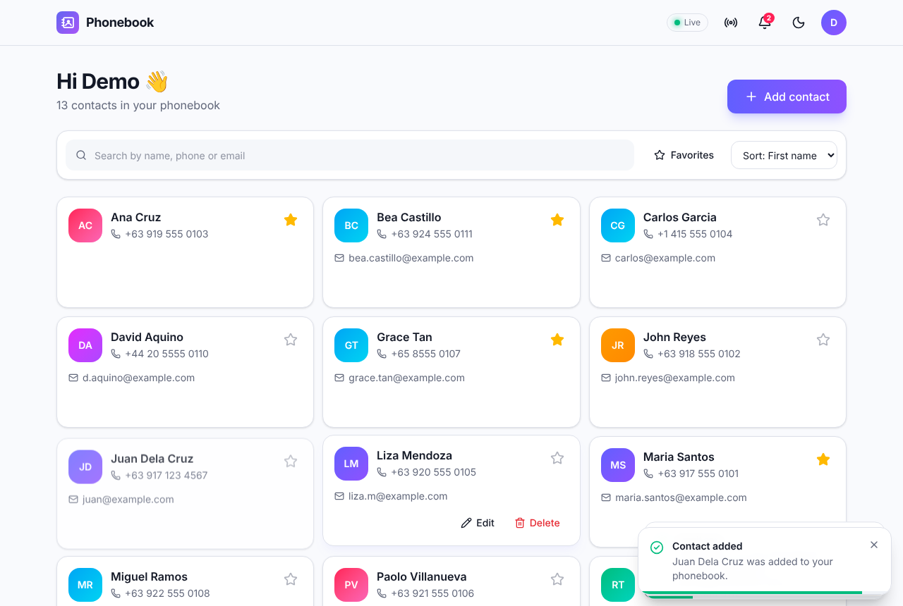
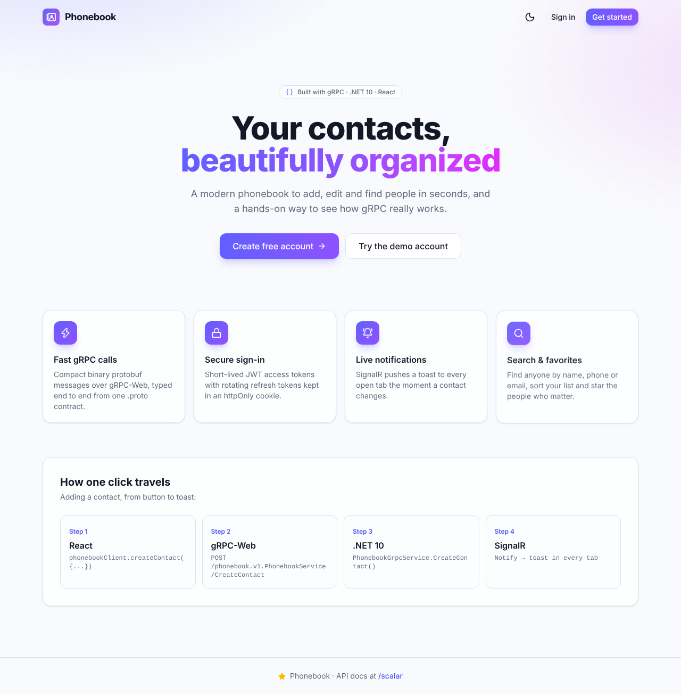
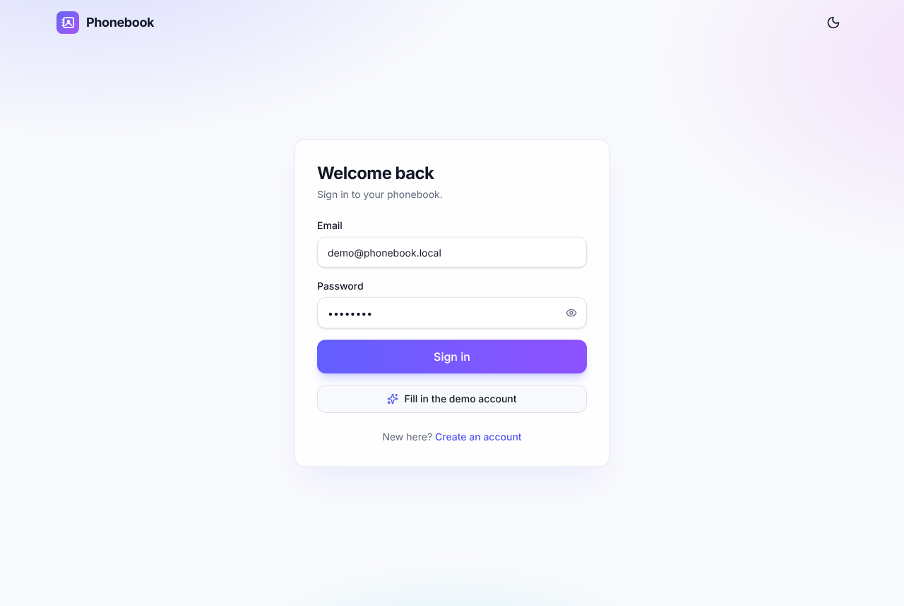
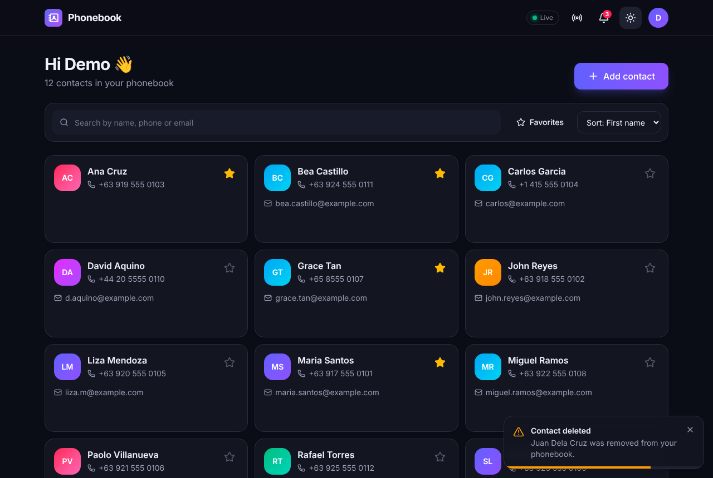
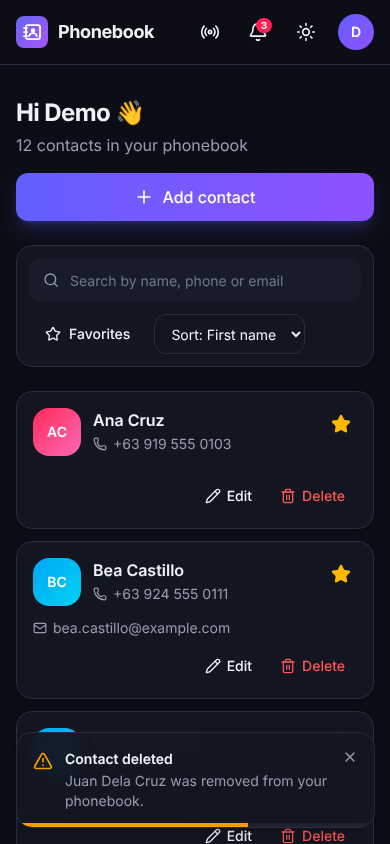
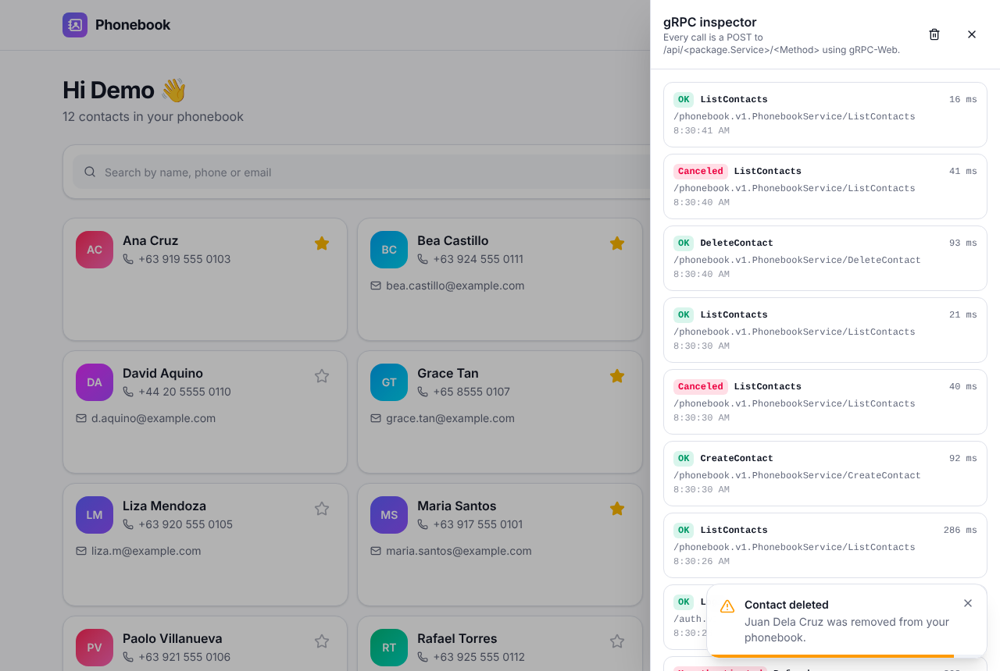

# 📇 Phonebook (gRPC)

A phonebook web app built to **learn gRPC**: a **.NET 10 gRPC** backend, a **React + TypeScript** frontend that talks to it with **gRPC-Web**, **JWT** access + refresh tokens, **SignalR** toast notifications, emails caught by **PaperCut SMTP**, **Scalar** API docs, unit + integration tests, and **Docker**.



| Landing | Sign in | Dark mode | Mobile |
|---|---|---|---|
|  |  |  |  |

The design and the reasoning behind it are in [Plan.MD](Plan.MD).

---

## Quick start (Docker)

```bash
cp .env.example .env          # then set JWT_SIGNING_KEY to a long random string
docker compose up --build
```

| What | URL |
|---|---|
| Web app | http://localhost:3000 |
| Scalar API docs | http://localhost:8080/scalar (also http://localhost:3000/scalar) |
| PaperCut inbox (all emails the app sends) | http://localhost:37408 |
| Native gRPC (HTTP/2) | `localhost:8081` |

Sign in with the demo account **demo@phonebook.local / Demo123!** (the "Fill in the demo account" button does it for you), or register a new account and check PaperCut for the welcome email.

## Run without Docker

You need the .NET 10 SDK and Node 22.

```bash
# Terminal 1: API on :8080 (gRPC-Web/REST/SignalR) and :8081 (native gRPC), SQLite database
cd backend/src/Phonebook.Api
dotnet run --environment Development

# Terminal 2: React dev server on :5173 (proxies /api, /hubs, /scalar to the API)
cd frontend
npm install
npm run dev

# Optional: PaperCut for emails (SMTP on :2525, inbox on :37408)
docker run -p 2525:2525 -p 37408:8080 changemakerstudiosus/papercut-smtp:7.8
```

## Tests

```bash
cd backend && dotnet test     # 94 tests: xUnit + FakeItEasy + Shouldly, plus in-memory integration tests
cd frontend && npm test       # 25 tests: Vitest + Testing Library
```

---

## Project layout

```
proto/                         ← the gRPC contract, shared by backend and frontend
  auth/v1/auth.proto
  phonebook/v1/phonebook.proto
backend/
  src/Phonebook.Domain          entities: User, Contact, RefreshToken
  src/Phonebook.Application     use cases (ContactService, AuthService), validation, interfaces; no gRPC here
  src/Phonebook.Infrastructure  EF Core (PostgreSQL/SQLite), JWT, password hashing, email queue + MailKit
  src/Phonebook.Api             gRPC services, interceptors, SignalR hub, Program.cs
  tests/Phonebook.UnitTests     services, validators, tokens, interceptor, repository (FakeItEasy fakes)
  tests/Phonebook.IntegrationTests  real gRPC / gRPC-Web / REST / SignalR calls against an in-memory server
frontend/
  src/gen                       TypeScript generated from /proto (npm run gen)
  src/api                       gRPC-Web transport, interceptors, token refresh, gRPC inspector
  src/auth                      AuthContext (login, silent refresh, logout), route guards
  src/notifications             SignalR connection + 5-second toasts
  src/pages, src/components     landing, login/register, contacts dashboard, dialogs
docker-compose.yml              Postgres + PaperCut + API + web (nginx)
```

---

## gRPC walkthrough

Follow one feature, **"add a contact"**, from contract to screen.

### 1. Contract first: `.proto`

Everything starts in [`proto/phonebook/v1/phonebook.proto`](proto/phonebook/v1/phonebook.proto):

```proto
service PhonebookService {
  rpc CreateContact (CreateContactRequest) returns (Contact) {
    option (google.api.http) = { post: "/v1/contacts" body: "*" };
  }
}
message CreateContactRequest {
  string first_name = 1;
  string last_name = 2;
  string phone_number = 3;
  ...
}
```

* A **service** is a set of **methods** (rpcs). You design functions, not URLs.
* **Messages** are serialized with **Protocol Buffers**: a compact binary format. Only the **field number** (`= 1`) goes on the wire, never the name. That's why field numbers must never change: it keeps old and new clients compatible.
* The `google.api.http` option is extra. It gives the same rpc a REST route (see step 7).

### 2. Code generation (both sides)

* **C#**: `Grpc.Tools` runs at build time (see the `<Protobuf>` items in `Phonebook.Api.csproj`) and generates `PhonebookService.PhonebookServiceBase` plus a class per message.
* **TypeScript**: `npm run gen` runs `buf generate` with `protoc-gen-es`, writing `frontend/src/gen/**`. The frontend gets typed messages and a service descriptor.

Both sides compile from the same file, so a renamed field breaks the build instead of production.

### 3. The server: override the generated base class

[`PhonebookGrpcService.cs`](backend/src/Phonebook.Api/Services/PhonebookGrpcService.cs):

```csharp
[Authorize]
public sealed class PhonebookGrpcService(IContactService contacts) : PhonebookService.PhonebookServiceBase
{
    public override async Task<Contact> CreateContact(CreateContactRequest request, ServerCallContext context)
    {
        var contact = await contacts.CreateAsync(context.GetUserId(), request.ToInput(), context.CancellationToken);
        return contact.ToProto();
    }
}
```

The class stays thin: protobuf message → plain C# input → application service → protobuf response. `ServerCallContext` carries the metadata, the deadline/cancellation token, and the underlying `HttpContext`. It's registered with `app.MapGrpcService<PhonebookGrpcService>()`.

### 4. Transport: HTTP/2 and gRPC-Web

Native gRPC is an **HTTP/2 POST** to `/<package>.<Service>/<Method>`, e.g. `/phonebook.v1.PhonebookService/CreateContact`. The body is length-prefixed protobuf. The result status comes in HTTP **trailers** (`grpc-status`, `grpc-message`).

Browsers can't read trailers or control HTTP/2 frames, so the frontend uses **gRPC-Web**: the same messages over a normal `fetch()`, with the trailers packed into the body. ASP.NET Core speaks gRPC-Web natively (`app.UseGrpcWeb()`), so there's no Envoy proxy.

The API listens on two ports:

* **8080, HTTP/1.1**: gRPC-Web, REST/JSON, SignalR, Scalar
* **8081, HTTP/2 cleartext**: native gRPC (Kestrel can't offer HTTP/1.1 and cleartext HTTP/2 on one port)

### 5. The client: a typed function call

[`frontend/src/api/clients.ts`](frontend/src/api/clients.ts):

```ts
export const phonebookClient = createClient(PhonebookService, transport);

const contact = await phonebookClient.createContact({ firstName: "Ana", phoneNumber: "+63 919 555 0103" });
```

Open the **gRPC inspector** (📡 button in the app header) next to your browser's Network tab to watch each call: service, method, status code, and duration.



### 6. Metadata, interceptors and errors

* **Metadata = HTTP headers.** The access token travels as `authorization: Bearer <jwt>`. ASP.NET Core's JWT middleware and `[Authorize]` work on gRPC exactly like on controllers.
* **Interceptors** are gRPC middleware.
  * Server: `LoggingInterceptor` logs every call. `ExceptionInterceptor` turns C# exceptions into gRPC status codes.
  * Client: `bearerInterceptor` adds the token. `refreshInterceptor` catches `UNAUTHENTICATED`, refreshes once, and retries. `inspectorInterceptor` feeds the inspector.
* **Status codes**, not HTTP codes:

  | Situation | Exception | gRPC status |
  |---|---|---|
  | Validation failed | `ValidationException` | `INVALID_ARGUMENT` + `validation-errors` trailer (JSON field errors) |
  | Contact not found / not yours | `NotFoundException` | `NOT_FOUND` |
  | Email already registered | `ConflictException` | `ALREADY_EXISTS` |
  | Bad login / expired session | `AuthenticationFailedException` | `UNAUTHENTICATED` |
  | Anything else | – | `INTERNAL` (details logged, not leaked) |

  The contact form reads the `validation-errors` trailer and shows each message under its field.

### 7. JSON transcoding + Scalar

`AddJsonTranscoding()` uses the `google.api.http` options to expose every rpc as REST as well:

```bash
curl -X POST localhost:8080/v1/auth/login -H 'content-type: application/json' \
     -d '{"email":"demo@phonebook.local","password":"Demo123!"}'
curl localhost:8080/v1/contacts?search=maria -H "authorization: Bearer <accessToken>"
```

`Microsoft.AspNetCore.Grpc.Swagger` builds an OpenAPI document from those routes, and **Scalar** renders it at `/scalar`. Click **Authorize**, paste the `accessToken`, and try any method. One C# method, three ways to call it: gRPC, gRPC-Web, REST.

### 8. Native gRPC with grpcurl

Server reflection is enabled, so tools can discover the services:

```bash
grpcurl -plaintext localhost:8081 list
grpcurl -plaintext -d '{"email":"demo@phonebook.local","password":"Demo123!"}' localhost:8081 auth.v1.AuthService/Login
grpcurl -plaintext -H "authorization: Bearer <accessToken>" -d '{"search":"ana"}' localhost:8081 phonebook.v1.PhonebookService/ListContacts
grpcurl -plaintext localhost:8081 grpc.health.v1.Health/Check
```

---

## Authentication (access + refresh tokens)

| Token | What | Lifetime | Where the browser keeps it |
|---|---|---|---|
| Access token | Signed JWT (`sub`, `email`, `name`) | 15 min | In memory only |
| Refresh token | 64 random bytes, stored **hashed** in the DB | 7 days | `httpOnly` `SameSite=Strict` cookie |

1. **Login/Register** return an access token. The refresh token is set as a cookie. Browser (gRPC-Web) calls don't get it in the response body, so JavaScript never sees it. Other clients like grpcurl and Scalar do.
2. Every call sends `authorization: Bearer <access token>`.
3. When a call fails with `UNAUTHENTICATED`, or a minute before expiry, the app calls **Refresh**. The old refresh token is revoked and a new pair is issued (**rotation**).
4. If an already-rotated refresh token shows up again, someone copied it: the whole token **family is revoked** and the user must sign in again.
5. On page reload the app silently calls Refresh with the cookie, so you stay signed in.

## Notifications (SignalR) and email (PaperCut)

gRPC here is request/response: the browser asks and the server answers. **SignalR** covers the other direction, the server pushing events. After a gRPC call changes data, the application layer calls `INotificationPublisher`. Its SignalR implementation sends a `Notify` event to **every open tab of that user**.

| Event | Toast |
|---|---|
| `ContactCreated` / `ContactUpdated` / `ContactDeleted` | "Contact added: …" (the contact list in other tabs refreshes too) |
| `SignedIn` | "New sign-in", shown in tabs that were already open |
| `EmailSent` | "\"Welcome to Phonebook\" was sent to …" |

Each toast **shows for 5 seconds and then hides**. A bar counts down the time, hovering pauses it, and at most 3 show at once.

Emails (welcome on register, sign-in alert on login) are queued on an in-memory channel. A background service sends them with MailKit, retrying 3 times. A slow or offline SMTP server never slows down or breaks a login. In Docker they go to **PaperCut**: open http://localhost:37408 to read them.

## Configuration

| Setting | Default | Notes |
|---|---|---|
| `ConnectionStrings__Phonebook` | `Data Source=phonebook.db` | |
| `Database__Provider` | `Sqlite` | `Postgres` in Docker (runs EF Core migrations) |
| `Database__SeedDemoData` | `true` | Creates the demo user + 12 contacts on an empty DB |
| `Jwt__SigningKey` | – | **Required**, at least 32 characters |
| `Jwt__AccessTokenMinutes` / `Jwt__RefreshTokenDays` | `15` / `7` | |
| `Jwt__RefreshCookieSecure` | `true` | `false` in docker-compose for plain-http localhost |
| `Smtp__Host` / `Smtp__Port` / `Smtp__Enabled` | `localhost` / `2525` / `true` | |
| `RateLimiting__AuthPermitLimit` | `20` | Auth calls per minute per IP |
| `ApiDocs__Enabled` | `true` | Scalar + OpenAPI |

## Troubleshooting

* **"Offline" badge in the header**: the SignalR connection is down. In dev, check that the API is running on :8080.
* **Signed out after a reload in Safari over http**: keep `REFRESH_COOKIE_SECURE=false` locally, or serve over HTTPS.
* **Changed a `.proto`?** Run `npm run gen` in `frontend/`. The backend regenerates on build.
